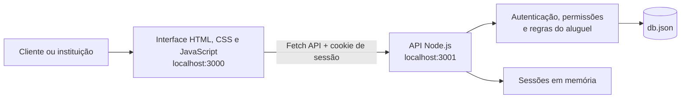

<!-- Documentação adaptada do template de README do Prof. Dr. João Paulo Aramuni. -->

# 🚗 Locadora Fácil

> [!NOTE]
> Sistema acadêmico de aluguel de carros que reúne cadastro de clientes, consulta de veículos, análise de pedidos e emissão de contratos em uma aplicação web.

<table>
  <tr>
    <td width="800">
      <div align="justify">
        A <b>Locadora Fácil</b> permite que clientes solicitem o aluguel de um veículo e acompanhem cada etapa do pedido. Empresas e bancos gerenciam seus próprios carros, avaliam solicitações e registram contratos. O projeto utiliza <b>HTML, CSS e JavaScript</b> na interface e uma <b>API Node.js</b> com persistência em arquivo JSON, facilitando a execução e a apresentação em laboratório.
      </div>
    </td>
    <td align="center" bgcolor="#0d6efd">
      
    </td>
  </tr>
</table>

---

## 🚧 Status do Projeto


---

## 📚 Índice

- [Links Úteis](#-links-úteis)
- [Sobre o Projeto](#-sobre-o-projeto)
- [Funcionalidades Principais](#-funcionalidades-principais)
- [Tecnologias Utilizadas](#-tecnologias-utilizadas)
- [Arquitetura](#-arquitetura)
- [Instalação e Execução](#-instalação-e-execução)
- [Estrutura de Pastas](#-estrutura-de-pastas)
- [Demonstração](#-demonstração)
- [Testes](#-testes)
- [Documentações de Referência](#-documentações-de-referência)
- [Autores](#-autores)

---

## 🔗 Links Úteis

- 🌐 **Aplicação local:** [http://localhost:3000](http://localhost:3000)
- 🔌 **API local:** [http://localhost:3001](http://localhost:3001) — utiliza as rotas descritas na seção de arquitetura.
- 📖 **Interface:** [dist/index.html](dist/index.html)
- ⚙️ **Código da API:** [server.cjs](server.cjs)

Os endereços locais ficam disponíveis após iniciar os serviços.

---

## 📝 Sobre o Projeto

O projeto simula o processo de aluguel de carros, desde a escolha do veículo até o registro do contrato. Foi desenvolvido para apresentação acadêmica, permitindo exercitar interfaces web, consumo de API, autenticação, regras de negócio e persistência de dados.

A aplicação oferece dois perfis: **Cliente** e **Empresa / Banco**. O cliente mantém seus dados cadastrais e solicita aluguéis. A instituição cadastra veículos e acompanha somente as solicitações e os contratos relacionados aos carros sob sua responsabilidade.

---

## ✨ Funcionalidades Principais

- 🔐 **Cadastro e login:** criação de contas, autenticação por sessão e saída da conta.
- 👤 **Meu cadastro:** edição de dados pessoais e preenchimento de até três fontes de renda pela interface.
- 🚗 **Catálogo de carros:** consulta de veículos, instituição responsável e valor da diária.
- 🏢 **Gestão de veículos:** cadastro de carros pela instituição, com vínculo automático à sua conta.
- 📝 **Pedidos de aluguel:** solicitação por período, consulta de detalhes, alteração e cancelamento conforme a situação do pedido.
- ✅ **Avaliação de pedidos:** aprovação ou recusa pela instituição responsável, com registro de parecer.
- 📄 **Contratos:** confirmação de pedidos aprovados e registro de aluguel simples ou com crédito simulado da instituição responsável.
- 📅 **Disponibilidade:** bloqueio de períodos de veículos com pedidos aprovados ou contratados.
- 🏠 **Painel inicial:** acompanhamento de contratos pendentes e ativos para clientes autenticados.
- 🧭 **Navegação responsiva:** ícones, destaque da seção ativa e rolagem horizontal dos links em telas pequenas.

### Regras do aluguel

- O período deve começar na data atual ou em uma data futura.
- As datas de retirada e devolução entram no cálculo: retirada e devolução no mesmo dia correspondem a uma diária.
- Pedidos pendentes não reservam o veículo. Pedidos aprovados e contratados bloqueiam o período.
- A disponibilidade é verificada novamente na aprovação e na contratação.
- Alterar um pedido exige nova avaliação. Após a contratação, o protótipo não permite alterar ou cancelar o pedido.
- Somente a instituição proprietária do veículo pode avaliar seus pedidos ou gerar seus contratos.
- No contrato com crédito, a instituição responsável pelo carro concede o valor simulado informado.

---

## 🛠 Tecnologias Utilizadas

### 💻 Front-end

| Tecnologia | Uso |
| --- | --- |
| HTML5 | Estrutura da aplicação e formulários |
| CSS3 | Identidade visual e adaptação a diferentes telas |
| JavaScript | Construção dinâmica das telas, validações e navegação |
| Bootstrap 5.3.3 | Componentes e organização visual, carregados via CDN |
| Fetch API | Comunicação com a API |
| Local Storage | Referência da conta e última seção acessada |
| SVG | Logo e ícones da navegação |

### 🖥️ Back-end e persistência

| Tecnologia | Uso |
| --- | --- |
| Node.js | Execução da API em `server.cjs` |
| Módulos nativos `http`, `fs`, `path` e `crypto` | Servidor HTTP, arquivos e identificadores de sessão |
| JSON | Persistência local em `db.json` |

### ⚙️ Ferramentas de execução

- **http-server 14.1.1:** serve os arquivos da pasta `dist/` na porta 3000.
- **concurrently 8.2.2:** inicia a interface e a API com um único comando.
- **npm:** executa os scripts definidos em `package.json`.

A aplicação não exige compilação. As ferramentas de execução são instaladas globalmente; a API utiliza apenas módulos nativos do Node.js.

---

## 🏗 Arquitetura

A interface é servida como arquivos estáticos. O JavaScript alterna as telas na mesma página e faz requisições HTTP à API, que autentica a conta, verifica permissões, aplica as regras do aluguel e lê ou grava o arquivo de dados.



### Principais componentes

| Componente | Responsabilidade |
| --- | --- |
| `dist/index.html` | Estrutura da página, cabeçalho e áreas de conteúdo |
| `dist/app.js` | Navegação, formulários, telas e chamadas à API |
| `dist/style.css` | Estilos complementares ao Bootstrap |
| `server.cjs` | Autenticação, autorização e operações sobre os dados |
| `db.json` | Contas, veículos, pedidos e contratos |

### Rotas principais da API

| Método | Rota | Finalidade |
| --- | --- | --- |
| `POST` | `/auth/login` | Iniciar a sessão |
| `POST` | `/auth/logout` | Encerrar a sessão |
| `GET` | `/auth/me` | Consultar a conta autenticada |
| `POST` | `/usuarios` | Cadastrar uma conta |
| `GET` / `PATCH` | `/usuarios` / `/usuarios/:id` | Consultar usuários conforme as permissões e atualizar o próprio cadastro |
| `GET` / `POST` | `/carros` | Consultar veículos ou cadastrar um veículo como instituição |
| `GET` / `POST` | `/pedidos` | Consultar pedidos acessíveis ou solicitar um aluguel |
| `PATCH` | `/pedidos/:id` | Alterar, cancelar ou avaliar conforme o perfil e a situação |
| `GET` / `POST` | `/contratos` | Consultar contratos acessíveis ou contratar um pedido aprovado |

As rotas de consulta de usuários, carros, pedidos e contratos exigem autenticação. As permissões são verificadas na API, incluindo o vínculo entre a instituição e o veículo.

### Sessão

O cookie de autenticação é HttpOnly e tem duração de sete dias. As sessões ficam em memória e são encerradas ao reiniciar a API. O navegador guarda apenas o ID da conta e a última seção acessada no Local Storage; ao recarregar, a conta é consultada novamente na API.

---

## 🚀 Instalação e Execução

### Pré-requisitos

- Node.js e npm instalados no computador.
- Navegador atualizado.
- Portas **3000** e **3001** disponíveis.
- Conexão com a internet para carregar o Bootstrap e os badges da documentação.

### 📦 Instalação de dependências

Na primeira utilização, instale as ferramentas globais:

```sh
npm install -g http-server@14.1.1 concurrently@8.2.2
```

Depois, abra o terminal na pasta do projeto, onde está o `package.json`. Não é necessário executar `npm install` nessa pasta: as ferramentas são encontradas pela instalação global.

### 💾 Inicialização dos dados

O arquivo [db.json](db.json) já contém dados de demonstração. A API consulta e atualiza esse arquivo diretamente; não é necessário instalar um banco de dados ou executar migrações.

Para preservar um cenário de apresentação, faça uma cópia de `db.json` antes de modificar os registros.

### ⚡ Como executar a aplicação

Inicie os dois serviços:

```sh
npm start
```

Acesse **[http://localhost:3000](http://localhost:3000)**. Mantenha os serviços em execução durante o uso e pressione `Ctrl+C` no terminal para encerrá-los.

Se preferir, utilize dois terminais na pasta do projeto:

| Terminal | Comando | Serviço |
| --- | --- | --- |
| 1 | `npm run api` | API em `http://localhost:3001` |
| 2 | `npm run site` | Interface em `http://localhost:3000` |

Se a API estiver fora do ar, a interface exibirá uma mensagem de erro.

---

## 📂 Estrutura de Pastas

```text
locadora-facil/
├── dist/
│   ├── index.html                  # Estrutura da aplicação
│   ├── style.css                   # Estilos e responsividade
│   ├── app.js                      # Telas e integração com a API
│   └── images/
│       ├── logo-carro-chave.svg     # Ícone da marca
│       └── carros/                 # Fotos locais dos veículos
├── server.cjs                      # API e regras de negócio
├── db.json                         # Dados persistidos localmente
├── package.json                    # Scripts de execução
├── .gitignore                      # Arquivos ignorados pelo Git
└── README.md                       # Documentação do projeto
```

---

## 🎥 Demonstração

### 🔐 Contas fictícias

| Perfil | E-mail | Senha |
| --- | --- | --- |
| Cliente | cliente@teste.com | 123456 |
| Empresa / Banco | empresa@teste.com | 123456 |
| Empresa / Banco | banco@teste.com | 123456 |

Também é possível cadastrar novas contas de cliente ou instituição para testar os perfis. Utilize somente dados fictícios.

### 🌐 Fluxo de apresentação da aplicação web

1. Entre como **Cliente** e abra **Meu cadastro**. Preencha os dados pessoais e pelo menos uma fonte de renda; a interface aceita até três empregadores e seus rendimentos.
2. Abra **Carros**, escolha um veículo e solicite um período a partir da data atual.
3. Em **Meus pedidos**, consulte os detalhes, altere ou cancele a solicitação. Uma alteração exige nova avaliação.
4. Saia da conta e entre como **Empresa / Banco** responsável pelo veículo. Em **Pedidos**, aprove ou recuse a solicitação com um parecer. Em **Carros**, use **Adicionar carro** para cadastrar um veículo vinculado à instituição.
5. Com o pedido aprovado, o cliente pode confirmá-lo, ou a instituição responsável pode gerar o contrato. Para a modalidade com crédito, informe o valor simulado concedido pela instituição responsável.
6. Confira o registro em **Contratos** e o acompanhamento no painel **Início** do cliente.

Os quatro veículos iniciais pertencem à Locadora Exemplo. Cada instituição acessa somente os pedidos dos seus próprios veículos.

### 💻 Exemplo de chamada à API

Com a API em execução, consulte a conta sem uma sessão autenticada:

```sh
curl -i http://localhost:3001/auth/me
```

A resposta deve ter status **401**, com o seguinte corpo:

```json
{
  "erro": "Entre novamente para continuar."
}
```

---

## 🧪 Testes

### Verificação de sintaxe

```sh
node --check server.cjs
node --check dist/app.js
```

Esses comandos verificam a sintaxe do JavaScript; não validam os fluxos de negócio.

### Roteiro de validação manual

| Cenário | Resultado esperado |
| --- | --- |
| Login com dados incorretos | Mensagem de erro e acesso negado |
| Recarregar uma página com sessão válida | Conta e seção restauradas |
| Solicitar aluguel sem dados pessoais e renda | Solicitação bloqueada com orientação para completar o cadastro |
| Aprovar dois pedidos do mesmo carro em períodos sobrepostos | Segundo pedido bloqueado por indisponibilidade |
| Acessar pedido de outra instituição | Acesso negado pela API |
| Alterar pedido antes da contratação | Nova análise exigida |
| Consultar pedido contratado | Alteração e cancelamento indisponíveis |
| Encerrar a sessão | Retorno à navegação sem autenticação |
| Navegar em tela pequena | Links acessíveis por rolagem horizontal |

---

## 📖 Documentações de Referência

- [MDN — HTML](https://developer.mozilla.org/pt-BR/docs/Web/HTML)
- [MDN — CSS](https://developer.mozilla.org/pt-BR/docs/Web/CSS)
- [MDN — JavaScript](https://developer.mozilla.org/pt-BR/docs/Web/JavaScript)
- [MDN — Fetch API](https://developer.mozilla.org/pt-BR/docs/Web/API/Fetch_API)
- [Bootstrap 5.3](https://getbootstrap.com/docs/5.3/getting-started/introduction/)
- [Node.js — API HTTP](https://nodejs.org/api/http.html)
- [http-server](https://github.com/http-party/http-server)
- [concurrently](https://github.com/open-cli-tools/concurrently)

---

## 👥 Autores

| Nome | Participação |
| --- | --- |
| Miguel Saraiva Ferreira | Autor do projeto |

---